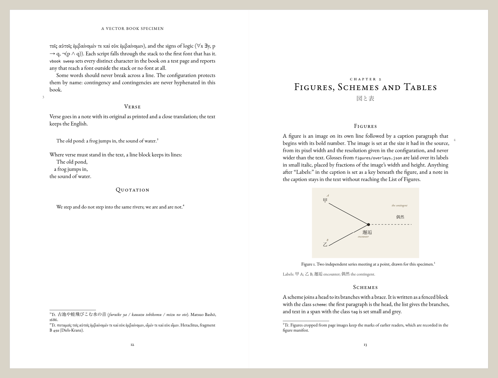
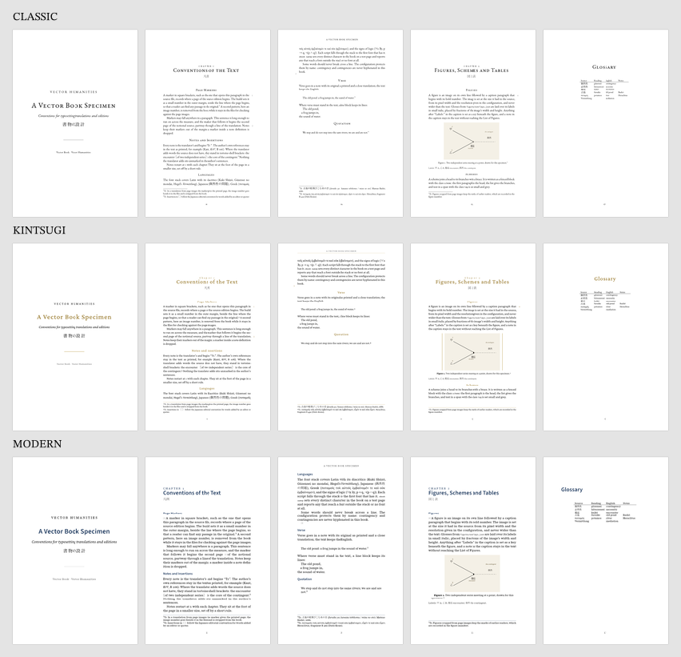

<p align="center"></p>

<h1 align="center">Vector Book</h1>
<p align="center">Book design and typesetting for vector humanities editions and translations<br>
<sub>A Vector Humanities tool · alpha · GPL-3.0</sub></p>

---

Vector Book typesets a book from Markdown section files. A short `book.toml` describes the book; `vbook build` assembles the sections, passes them through Pandoc with a Lua filter, and sets them in Typst. The design comes from the vector translation of Kuki Shūzō's 偶然性の問題 (*The Problem of Contingency*, 1935): Royal octavo, EB Garamond, centred small-capital headings, and the source edition's page numbers in the outer margin.

<p align="center"></p>

## Use

Needs Python 3.11+, Pandoc 3 and Typst 0.13 or later.

```bash
./vbook new mybook          # start from the starter project
./vbook build mybook        # assemble, convert, compile
./vbook check mybook        # notes and figures set against the sources; missing glyphs (--report: book/BUILD.md)
./vbook sweep mybook        # every non-ASCII character, checked for font fallback
./vbook proof mybook        # contact sheet of the pages
./vbook samples mybook      # the book in every template, matching pages side by side
./vbook fonts mybook        # the font stacks, and which are installed
```

Three templates come from the design samples made for Kuki: `classic` (the one chosen), `modern` and `kintsugi`.

<p align="center"></p>

The specimen in [`examples/specimen/`](examples/specimen/) shows every convention and builds to [`examples/specimen/book/specimen.pdf`](examples/specimen/book/specimen.pdf).

## Documentation

| | |
|---|---|
| [`docs/conventions.md`](docs/conventions.md) | What the Markdown says: chapters, page markers, notes, insertions, verse, figures and overlays, schemes, tables, glossary |
| [`docs/config.md`](docs/config.md) | Every key in `book.toml` |
| [`docs/handover.md`](docs/handover.md) | How a finished vector translation passes to Vector Book: the book folder, the manifest, the flow from sign-off to proof |
| [`docs/practice.md`](docs/practice.md) | How to make a book, from what the Kuki book needed, with the faults met and how the tool handles them |
| [`AGENTS.md`](AGENTS.md) | Instructions for agents working on this repository |

Vector Book is stage 7 of the Vector Translation method, and serves editions as well as translations.

## Layout

```
vbook                command
lib/                 Pandoc Lua filter and shared Typst functions
templates/           page designs: classic, modern, kintsugi
covers/              frame and plain covers
starter/             the project vbook new copies
examples/specimen/   a book that uses every convention
docs/                conventions, configuration, practice
brand/               the mark and its generator
```

## Status

Alpha, October 2026. The full Kuki book builds through it: 473 notes and 22 figures set, no missing glyphs. To come: a facing-page layout for literal and readable versions, EPUB and HTML output, and open CJK fonts for builds away from macOS.

Licence: GNU General Public License, version 3 or later.
