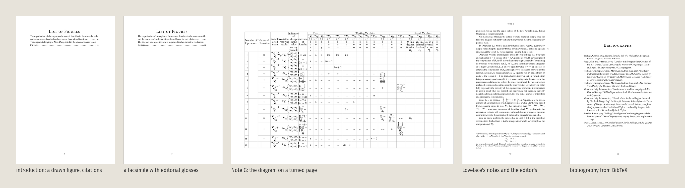

<p align="center"></p>

<h1 align="center">Vector Book</h1>
<p align="center">Book design and typesetting for vector humanities editions and translations<br>
<sub>A Vector Humanities tool · alpha · GPL-3.0 · <a href="https://vector-humanities.github.io/vector-book/">vector-humanities.github.io/vector-book</a></sub></p>
<p align="center"><a href="https://doi.org/10.5281/zenodo.23736367"></a></p>

---

Vector Book typesets a book from Markdown section files. A short `book.toml` describes the book; `vbook build` assembles the sections, passes them through Pandoc with a Lua filter, and sets them in Typst. Its first design was made for the vector translation of Kuki Shūzō's 偶然性の問題 (*The Problem of Contingency*, 1935): Royal octavo, EB Garamond, centred small-capital headings, and the source edition's page numbers in the outer margin. Five designs are available, and every book can be set in all of them with one command.

<p align="center"></p>

## Five designs

**Classic.** The design chosen for Kuki. EB Garamond at 10.5 pt on a 156 × 234 mm page; centred small-capital headings; the printed source's page numbers set small in the outer margin, on the baseline of the line where each page begins; notes restarting with each chapter under a short rule.

<p align="center"></p>
<p align="center"></p>

**Modern.** Source Serif 4 for the text, Source Sans 3 semibold for headings in navy, set flush left; source pages inline as small grey `[N]`; a full-width rule above the notes.

<p align="center"></p>
<p align="center"></p>

**Kintsugi.** Crimson Pro with Shippori Mincho; centred headings in gold; section numbers as kanji (一, 二, …); gold hairlines under the running head and above the notes; figures set between gold rules.

<p align="center"></p>
<p align="center"></p>

**Organic.** A 130 × 190 mm paperback in the manner of contemporary theory publishing. Fira Sans Condensed for the text; chapter titles in huge Archivo capitals, stacked and broken across lines; before every chapter, a field page generated from the book itself, regions of black, colour and white stipple drawn from a noise surface seeded by the book's title, so that no two books and no two chapters share a field; a field cover; a huge Contents; a black back cover.

<p align="center"></p>
<p align="center"></p>
<p align="center"></p>

The organic design's colours are chosen in `book.toml`: six palettes, or your own list, and the ink of the solid regions. On the cover the ink opens around the title, so the title never stands on black.

<p align="center"></p>

**Vectors.** A 140 × 216 mm book drawn from vector spaces. IBM Plex Serif for the text, Bricolage Grotesque for headings, IBM Plex Mono for running heads, labels and source pages. Every chapter opens under a band of generated imagery with its title set large over it, and before every chapter stands a full page of it: streamlines, arrow fields, tensor glyphs drawn along the flow, a coordinate grid bent by the flow into a manifold, point clouds with labelled basis vectors. All of it comes from one flow field per page, seeded by the book's title and the chapter's place in it. Every other page inverts the palette. Type over imagery carries a halo in the ground colour, so it reads on any palette.

<p align="center"></p>
<p align="center"></p>
<p align="center"></p>

Five palettes (`vector-palette`: electric, night, blueprint, garden, spectrum), or your own ground, ink and colours:

<p align="center"></p>

## A sample edition

[*Sketch of the Analytical Engine*](examples/lovelace/book/lovelace.pdf): L. F. Menabrea's memoir of 1842, as translated with Notes A to G by Ada Lovelace in 1843, set from the Wikisource transcription of *Scientific Memoirs*. It carries what a scholarly edition needs: the 1843 page numbers in the margin; Lovelace's footnotes and the editor's in one series, including notes on a chapter title, in a figure caption and in table cells, notes with quotations and displayed mathematics, and notes with citations; mathematics in the text throughout; Lovelace's tables and diagrams, the two widest on turned pages; a figure drawn for the edition and a facsimile with editorial glosses; a glossary; and a bibliography formatted from BibTeX by citeproc. 96 pages; the sources are in [`examples/lovelace/`](examples/lovelace/), with the scripts that took the text from Wikisource.

<p align="center"></p>

## Front matter

Cover, frontispiece, title page, an imprint page (publisher and series, edition, copyright and moral rights, licence, third-party material, AI disclosure, cataloguing, ISBN per format, DOI, and a typesetting line Vector Book writes from the faces the book's characters reach), Contents and List of Figures, all from `book.toml`.

<p align="center"></p>

## Details

Source page numbers in the margin, set on the baseline of the line where the source page begins:

<p align="center"></p>

Figures at the size they had in the source, with English glosses laid over their labels and a key beneath; a note in the caption stays in the text and out of the List of Figures:

<p align="center"></p>

Schemes joined by a brace, and tables that break across pages with their columns sized to their contents:

<p align="center"></p>

A generated field, at print resolution:

<p align="center"></p>

## Making a book

The steps below take a book from an empty folder to a PDF. They were run on macOS; on Linux the same commands work once the programs and fonts are installed, with open fonts in place of the Apple ones (see step 6).

### 1. Install

Vector Book needs Python 3.11 or later (standard library only), Pandoc 3, Typst 0.13 or later, and Poppler (`pdffonts` and `pdfinfo`, used by the checks). With Homebrew:

```bash
brew install python pandoc typst poppler
git clone https://github.com/vector-humanities/vector-book.git
```

Then install the fonts for the designs you want. Hiragino, Menlo and Apple Symbols come with macOS; the rest are open fonts:

| Design | Fonts | Homebrew casks |
|---|---|---|
| all | Gentium Book Plus, Noto Serif JP, STIX Two, DejaVu Sans Mono | `font-gentium-book-plus font-noto-serif-jp font-stix font-dejavu` |
| classic | EB Garamond 12 | `font-eb-garamond` |
| modern | Source Serif 4, Source Sans 3 | `font-source-serif-4 font-source-sans-3` |
| kintsugi | Crimson Pro, Shippori Mincho | `font-crimson-pro font-shippori-mincho` |
| organic | Fira Sans Condensed, Archivo Black | `font-fira-sans-condensed font-archivo-black` |
| vectors | IBM Plex Serif and Mono, Bricolage Grotesque, Space Grotesk | `font-ibm-plex-serif font-ibm-plex-mono font-bricolage-grotesque font-space-grotesk` |

```bash
brew install --cask font-gentium-book-plus font-noto-serif-jp font-stix font-dejavu font-eb-garamond
```

`vbook fonts mybook` prints the stacks the book's template uses and marks each face `ok` or missing.

### 2. Start the book

Vector Book stays in its own folder and is called by path; nothing is copied into the book's repository. `vbook new` makes a book folder from the starter project:

```bash
path/to/vector-book/vbook new mybook
```

```
mybook/
  book.toml            the manifest: title, credits, design, sources, imprint, cover, back
  front/00-preface.md  front matter, in filename order
  text/01-introduction.md
  back/                appendices; the glossary is set last if book.toml names one
  figures/overlays.json   English glosses to lay over figure labels
  proof/return.md      the form for returns to the translation side
```

A book that already exists as a document comes in through `vbook import`, which reads anything Pandoc reads (Word `.docx`, OpenDocument `.odt`, Markdown, HTML, EPUB, LaTeX, RTF):

```bash
path/to/vector-book/vbook import mybook draft.docx
```

It splits the document at its level-one headings into numbered files in `text/` (anything before the first heading goes to `front/00-front-matter.md`), keeps each footnote with its chapter, extracts the images to `figures/`, and, for a new book, writes `book.toml` with the document's title. Page markers such as `[p. 12]` typed in the document come through as markers. Check the result with `vbook check`; Word styles that Markdown cannot express (colours, underlining, text boxes) are dropped.

The examples below are run from the vector-book folder, as `./vbook`; from anywhere else, give the path to `vbook`.

### 3. Fill in `book.toml`

Edit `[book]`: title, subtitle, author, original title, credit line ("Vector translated by …"), affiliation and the credits paragraph. Under `[design]`, `template` picks the design (`classic`, `modern`, `kintsugi`, `organic`, `vectors`) and `cover` the cover (`plain` or `frame` for the first three; organic and vectors bring their own). `[sources]` lists the section files by glob, `[markers]` gives the source page-marker pattern, and `[imprint]` fills the page behind the title page: publisher, series, edition, copyright, licence, AI disclosure, cataloguing, ISBN and DOI. Every key is in [`docs/config.md`](docs/config.md); a key left out takes its default, and a missing imprint field leaves no gap.

### 4. Write or drop in the text

One Markdown file per section, numbered in reading order (`01-`, `02-`, …). A level-one heading opens a chapter; attributes give its number, original title and running head:

```markdown
# Categorical Contingency {num="Chapter 1" orig="定言的偶然" run="Categorical Contingency"}

[p. 12] The text of the chapter, with the source edition's page twelve beginning here.[^c1-1]

[^c1-1]: Tr. A translator's note.
```

`[p. N]` marks where a page of the source begins and is set in the margin. Notes are Pandoc footnotes with labels unique across the book. A figure is an image on its own line followed by a caption paragraph beginning **Figure N.**; glosses for its labels go in `figures/overlays.json`. Schemes, section breaks, verse, tables, the glossary and raw Typst are in [`docs/conventions.md`](docs/conventions.md). Working notes between `<!-- working -->` and `<!-- /working -->` stay in the files and are left out of the book. A finished vector translation arrives in this shape from the Vector Translation method ([`docs/handover.md`](docs/handover.md)).

### 5. Build and check

```bash
./vbook build mybook        # the PDF, at book/book.pdf (or [book] output)
./vbook check mybook        # page count; notes and figures set against the sources; missing glyphs
```

`check` rebuilds first and prints, for the starter book:

```
pages    10
notes    1 set, 1 defined in the sources
figures  0 set, 0 in the sources
glyphs   no missing glyphs
```

A note or figure the sources define but the book does not set is a fault to fix before going further. `check --report` writes the same to `book/BUILD.md`, with the Vector Book commit, so the book can be rebuilt with the same version. Build after every chapter is added; each fault listed in [`docs/practice.md`](docs/practice.md) would have shown in a one-chapter book.

### 6. Fonts and characters

```bash
./vbook sweep mybook
```

sets every non-ASCII character in the book on test pages, grouped by Unicode block, and reports a character that falls back to a font outside the stack or reaches none. Fix a missing glyph by adding a face to `[design] fonts.text`. A `fonts/` folder in the book folder is passed to Typst, so a book can carry its own open fonts for builds away from macOS.

### 7. Choose the design

```bash
./vbook samples mybook      # build/samples.png and build/samples/<design>.pdf
```

sets the book's own pages (title page, chapter opening, a text page, a figure, the last chapter) in all five designs side by side, so the design is chosen on the text being typeset. Set the choice in `[design] template`. Organic takes `field-palette` (`mint-pink`, `acid`, `sand-sky`, `coral`, `electric`, `mono`) and vectors `vector-palette` (`electric`, `night`, `blueprint`, `garden`, `spectrum`), or your own colours; the generated imagery is seeded by the title, so each book has its own.

### 8. Proof and return

```bash
./vbook proof mybook                   # build/proof.png: every page on one contact sheet
./vbook proof mybook --pages 1-12      # some pages only
./vbook return mybook                  # check, then write proof/return-NN.md
```

`return` lists the faults the checks can locate (duplicate or undefined note labels, missing images, unkeyed captions, glyph faults) with file and line, for the translation side to fix in the sources. Add what proofreading finds under them by hand; [`docs/handover.md`](docs/handover.md) sets out the kinds, responses and the book gate. Rebuild after each round of fixes.

### 9. Publish

Add the ISBN and DOI to `[imprint]` when they are assigned, rebuild, and run `check --report` for the final `BUILD.md`. The PDF in `book/` is the book.

The specimen in [`examples/specimen/`](examples/specimen/) uses every convention and builds to [`examples/specimen/book/specimen.pdf`](examples/specimen/book/specimen.pdf); its files show how each is written. The gallery images are made by [`docs/src/gallery.py`](docs/src/gallery.py) from the specimen built in every template.

## Documentation

| | |
|---|---|
| [`docs/conventions.md`](docs/conventions.md) | What the Markdown says: chapters, page markers, notes, insertions, verse, figures and overlays, schemes, breaks, tables, glossary |
| [`docs/config.md`](docs/config.md) | Every key in `book.toml`, and the five templates |
| [`docs/handover.md`](docs/handover.md) | How a finished vector translation passes to Vector Book: the book folder, the manifest, returns and checks, the book gate |
| [`docs/practice.md`](docs/practice.md) | How to make a book, from what the Kuki book needed, with the faults met and how the tool handles them |
| [`AGENTS.md`](AGENTS.md) | Instructions for agents working on this repository |

Vector Book is stage 7 of the Vector Translation method, and serves editions as well as translations.

## Citation

Berry, D. M. (2026) *Vector Book: book design and typesetting for vector humanities editions and translations*. Version 0.1.1. Zenodo. https://doi.org/10.5281/zenodo.23736368

To cite every version, use the concept DOI, https://doi.org/10.5281/zenodo.23736367. `CITATION.cff` gives the same record for GitHub's "Cite this repository".

## Layout

```
vbook                command
lib/                 Pandoc Lua filter, shared Typst functions, the field and vector generators
templates/           page designs: classic, modern, kintsugi, organic, vectors
covers/              frame, plain, field and vector covers
starter/             the project vbook new copies
examples/specimen/   a book that uses every convention
examples/lovelace/   the sample edition: Menabrea and Lovelace, Sketch of the Analytical Engine (1843)
docs/                documentation, gallery images, the site
brand/               the mark and its generator
```

## Status

Alpha, October 2026. The full Kuki book builds in every design: 473 notes and 22 figures set, no missing glyphs (classic 242 pp., organic 284 pp., vectors 300 pp.). The Lovelace sample edition builds in every design: 37 notes, 2 figures, two tables on three turned pages. To come: a facing-page layout for literal and readable versions, EPUB and HTML output, and open CJK fonts for builds away from macOS.

Created by David M. Berry. Licence: GNU General Public License, version 3 or later.
